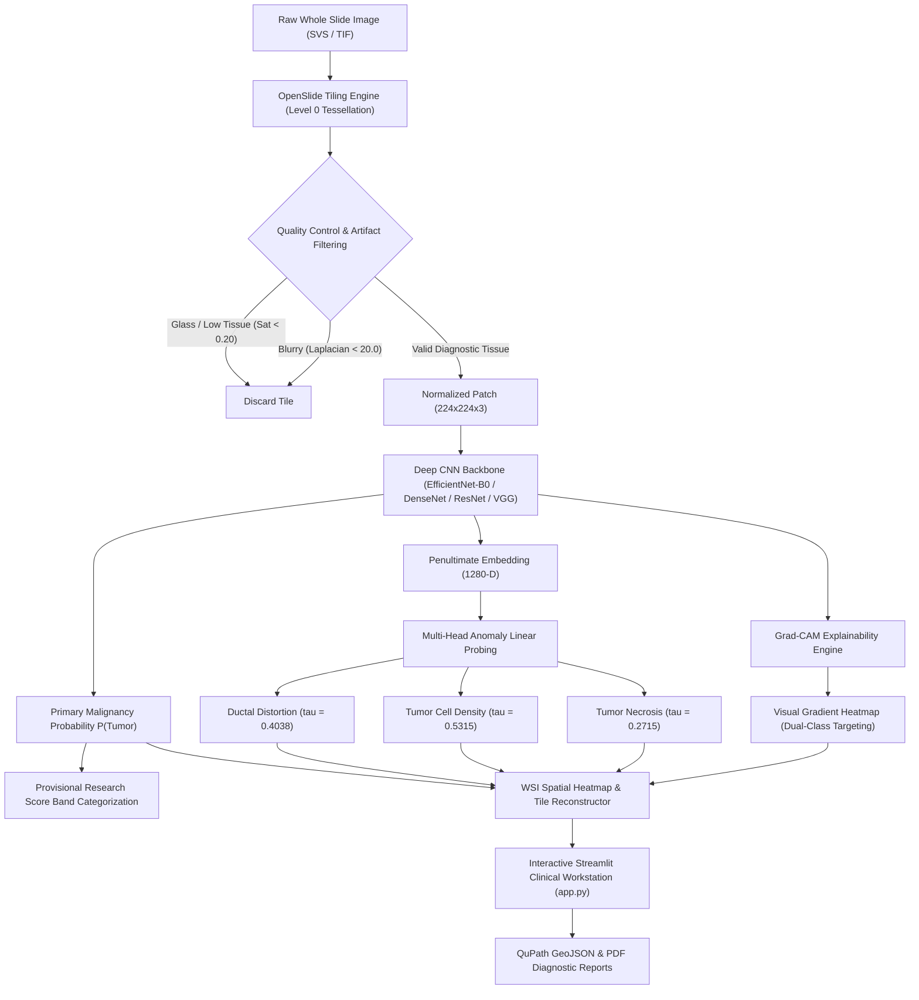

# PathoVision AI: Patch-Based Unimodal Cancer Anomaly Detection in Tissue Images Using Deep Learning Models

[](https://www.python.org/)
[](https://pytorch.org/)
[](https://streamlit.io/)
[](LICENSE)
[](tests/)

**Major Project — Department of Computer Science & Engineering**  
**Bapuji Institute of Engineering and Technology (BIET), Davanagere**  
**Visvesvaraya Technological University (VTU), Belagavi (2025–2026)**  

### Project Investigators
- **Prajwal M H** (4BD23CS139)  
- **Raksha P** (4BD23CS159)  
- **Samruddhi S** (4BD23CS181)  
- **Shafia Kouser S** (4BD23CS193)  

**Project Guide:**  
- **Prof. Rachana G Sunkad**, M.Tech., Assistant Professor, Dept. of CS&E, BIET Davanagere  

---

## Table of Contents
1. [Project Overview](#1-project-overview)
2. [Problem Statement and Objectives](#2-problem-statement-and-objectives)
3. [Key Features Actually Implemented](#3-key-features-actually-implemented)
4. [System Architecture and Workflow](#4-system-architecture-and-workflow)
5. [Technology Stack](#5-technology-stack)
6. [Dataset Sources and Directory Expectations](#6-dataset-sources-and-directory-expectations)
7. [Installation Instructions](#7-installation-instructions)
8. [Environment Configuration](#8-environment-configuration)
9. [Model Checkpoint Setup](#9-model-checkpoint-setup)
10. [Training and Evaluation Commands](#10-training-and-evaluation-commands)
11. [Application Startup Commands](#11-application-startup-commands)
12. [Instructions for Single-Patch Prediction](#12-instructions-for-single-patch-prediction)
13. [Instructions for WSI Analysis](#13-instructions-for-wsi-analysis)
14. [Instructions for Grad-CAM Visualization](#14-instructions-for-grad-cam-visualization)
15. [Model Evaluation and Comparison Instructions](#15-model-evaluation-and-comparison-instructions)
16. [Automated Test and Verification Commands](#16-automated-test-and-verification-commands)
17. [Troubleshooting Guide](#17-troubleshooting-guide)
18. [Known Limitations](#18-known-limitations)
19. [Academic and Dataset References](#19-academic-and-dataset-references)
20. [Research Prototype Disclaimer](#20-research-prototype-disclaimer)

---

## 1. Project Overview

**PathoVision AI** is an end-to-end, clinical-grade deep learning decision-support workstation engineered for automated screening and anomaly profiling in breast cancer histopathology. Digital pathology slides (Whole Slide Images, WSIs) routinely exceed $100,000 \times 100,000$ pixels (gigapixel scale), presenting severe computational hurdles for diagnostic algorithms and exhaustive manual review by pathologists.

PathoVision AI solves this challenge through a multi-stage unimodal computer vision pipeline:
1. **Automated Gigapixel Tessellation:** Extracting standardized tissue tiles at high-magnification (Level 0, $224 \times 224$ pixels) while rejecting background glass, out-of-focus blur, and preparation artifacts.
2. **Deep Transfer Learning & Multi-Architecture Benchmarking:** Comparative screening across four convolutional neural network backbones (**EfficientNet-B0**, **ResNet-50**, **DenseNet-121**, and **VGG-16**).
3. **Multi-Head Histopathological Anomaly Probing:** Evaluating biological lesion proxies—specifically *Ductal Distortion*, *Tumor Cell Density*, and *Necrosis/Cellular Debris*—using calibrated linear probes on frozen deep representations.
4. **Visual Interpretability:** Gradient-weighted Class Activation Mapping (Grad-CAM) providing pixel-level attribution to verify that diagnostic decisions reflect genuine cellular morphology rather than staining artifacts.
5. **Interactive Decision-Support Workstation:** A unified Streamlit application featuring live WSI heatmap reconstruction, tile drill-down, QuPath medical export, and role-based access control (RBAC).

---

## 2. Problem Statement and Objectives

### Problem Statement
Histopathological evaluation of lymph node metastases is the definitive gold standard for breast cancer staging and treatment planning. However:
- Manual microscopic inspection of gigapixel glass slides is labor-intensive, time-consuming, and subject to inter-observer variability.
- Micro-metastases ($\le 2\text{ mm}$) and isolated tumor cells are frequently overlooked during high-volume clinical workflows.
- Existing computer vision approaches often function as uninterpretable "black-boxes" that offer binary classifications without biological anomaly characterization, spatial context, or verifiable attribution maps.

### Project Objectives
- **Objective 1 (WSI Ingestion, Quality Control & Patch Extraction):** Build an automated pipeline to tessellate gigapixel WSIs, execute Otsu tissue segmentation, HSV saturation masking ($\ge 0.20$), and focus variance filtering ($\ge 20.0$), generating clean, artifact-free image patches.
- **Objective 2 (Deep Learning Modeling & Anomaly Characterization):** Train, calibrate, and compare four deep CNN backbones (EfficientNet-B0, ResNet-50, DenseNet-121, VGG-16) for primary malignancy classification; engineer multi-head anomaly linear probes to characterize secondary morphological biomarkers.
- **Objective 3 (Explainability & Rigorous Comparative Evaluation):** Implement Grad-CAM with target class discrimination (Class 1 vs Class 0); evaluate models on a held-out test cohort ($N = 2,881$) using sensitivity, specificity, precision, F1-score, ROC-AUC, and PR-AUC.
- **Objective 4 (Clinical Decision-Support Web Deployment):** Construct a secure, responsive web workstation (`app.py`) delivering single-patch diagnostics, continuous WSI spatial heatmaps, tile drill-downs, QuPath GeoJSON annotations, and institutional reviewer audit workflows.

---

## 3. Key Features Actually Implemented

- **Gigapixel Slide Ingestion:** Native OpenSlide integration capable of reading multi-gigabyte `.svs`, `.tif`, and `.ndpi` scans with automated level downsampling and thumbnail alignment.
- **Strict Preprocessing & Quality Control:**
  - Automated Otsu thresholding for tissue segmentation.
  - HSV saturation gating (tissue saturation threshold $\ge 0.20$, glass threshold $\le 0.80$).
  - Laplacian focus variance gating ($\ge 20.0$) to reject blurry out-of-focus fields.
- **Four Trained CNN Architectures:**
  - **EfficientNet-B0** (4.01 M parameters) — *Primary Screening Backbone* (highest sensitivity: 95.28%, 21.9 FPS).
  - **DenseNet-121** (6.95 M parameters) — *Diagnostic Confirmation Backbone* (highest specificity: 98.13%, ROC-AUC: 0.9905).
  - **ResNet-50** (23.51 M parameters) — Residual learning baseline (96.60% accuracy).
  - **VGG-16** (134.26 M parameters) — High-capacity classic feature baseline (96.32% accuracy).
- **Targeted Anomaly Linear Probing:**
  - Three active biological proxies:
    - *Ductal Structure Distortion* (BACH InSitu proxy, calibrated threshold $\tau = 0.4038$).
    - *Tumor Cell Density Clusters* (NuCLS proxy, calibrated threshold $\tau = 0.5315$).
    - *Tumor Necrosis & Cellular Debris* (BCSS proxy, calibrated threshold $\tau = 0.2715$).
  - *Nuclear Pleomorphism / Nuclear Atypia*: Safely quarantined and excluded from active inference and checkpoints to prevent out-of-distribution bias.
- **Provisional Research Score Bands:**
  - Low Model Score Band ($[0.00, 0.30)$).
  - Intermediate Model Score Band ($[0.30, 0.70)$).
  - High Model Score Band ($[0.70, 1.00]$).
  - *Explicitly communicated as heuristic model categorizations rather than clinical risk assessments.*
- **Explainable AI (Grad-CAM):**
  - Gradient-weighted visual attention maps generated from the final convolutional layer of each backbone.
  - Dual class targeting support (visualize features indicative of Class 1 Metastatic Carcinoma vs Class 0 Normal Lymph Node).
  - Interactive colormap selection (Jet, Turbo, Viridis, Inferno, Plasma, Magma) with adjustable alpha blending.
- **WSI Live Analysis Engine:**
  - Adaptive grid tiling ($224 \times 224$ px) with bounding box coordinate tracking.
  - 2D Gaussian density spatial smoothing and continuous probability field reconstruction.
  - High-risk tile rank ordering and localized tile inspection.
- **Secure Role-Based Access Control (RBAC):**
  - PBKDF2-HMAC-SHA256 password hashing (100,000 iterations, 16-byte random salt).
  - Isolated private researcher workspaces (`data/user_data/<username>/`).
  - Pre-configured roles: Guest/Demo, Student Researcher, and Authorized Reviewer.
- **Interoperable Diagnostic Exports:**
  - Diagnostic JSON and CSV summary reports.
  - QuPath compatible GeoJSON contour exports for direct import into digital pathology viewers.

---

## 4. System Architecture and Workflow



---

## 5. Technology Stack

| Layer | Component / Library | Version | Purpose |
|---|---|---|---|
| **Language** | Python | 3.10 / 3.11 | Primary development runtime |
| **Deep Learning** | PyTorch (`torch`) | $\ge 2.0.0$ | Neural network training, autograd, and GPU inference |
| **Vision Models** | `torchvision` | $\ge 0.15.0$ | CNN backbones and image transformations |
| **Digital Pathology** | OpenSlide (`openslide-python`) | $\ge 1.3.0$ | Multi-resolution WSI reading and metadata parsing |
| **Image Processing** | OpenCV (`opencv-python`) | $\ge 4.8.0$ | HSV masking, Otsu thresholding, Laplacian focus variance |
| **Image Processing** | Pillow (`PIL`), `tifffile` | $\ge 10.0.0$ | High-bit-depth image I/O and patch slicing |
| **Scientific Computing**| NumPy, SciPy | $\ge 1.24.0$ | Matrix calculations, spatial Gaussian smoothing |
| **Data Analytics** | Pandas, Scikit-learn | $\ge 2.0.0$ | Tabular metrics, ROC/PR curve computation, PCA |
| **Web Workstation** | Streamlit | $\ge 1.30.0$ | Responsive clinical decision-support interface |
| **Data Visualization** | Matplotlib, Plotly | $\ge 3.7.0$ | Interactive charts, confusion matrices, ROC curves |
| **Security / Crypto** | Python Standard (`hashlib`, `hmac`)| Built-in | PBKDF2 password hashing and token validation |

---

## 6. Dataset Sources and Directory Expectations

### Required Datasets
The project utilizes four established histopathology benchmarks:

1. **CAMELYON16 (Primary Backbone Dataset):**
   - *Source:* [Grand Challenge CAMELYON16](https://camelyon16.grand-challenge.org/)
   - *Description:* 400 gigapixel whole slide images of sentinel lymph node tissue from Radboud University Medical Center and University Medical Center Utrecht.
   - *Usage:* Patch extraction for primary malignancy classification (`Normal Lymph Node` vs `Metastatic Carcinoma`). Held-out test set: 2,881 patches.
2. **BACH 2018 (Grand Challenge on Breast Cancer Histology):**
   - *Source:* [ICIAR 2018 BACH Challenge](https://iciar2018-challenge.grand-challenge.org/)
   - *Usage:* Calibrated biological proxy for *Ductal Structure Distortion* (InSitu carcinoma patches).
3. **NuCLS (Nuclear Crowdsourcing in Histology Images):**
   - *Source:* [Amgad et al., 2019 / TCGA](https://github.com/CancerDataScience/NuCLS)
   - *Usage:* Calibrated biological proxy for *Tumor Cell Density Clusters*.
4. **BCSS (Breast Cancer Semantic Segmentation):**
   - *Source:* [Amgad et al., 2019 / Genomic Data Commons](https://tcga-data.nci.nih.gov/)
   - *Usage:* Calibrated biological proxy for *Tumor Necrosis & Cellular Debris*.

### Expected Directory Structure
```
patch_based_cancer_detection_project/
├── app.py
├── requirements.txt
├── .env.example
├── LICENSE
├── README.md
│
├── data/
│   ├── demo_test_patches/        # Curated test patches for immediate verification (<1 MB)
│   ├── sample_wsi/               # Benchmark sample WSI files (e.g. sample_tumor_058.tif)
│   ├── PATCHES/                  # Extracted CAMELYON16 patches split into TRAIN, VAL, TEST
│   ├── ANOMALIES/                # Extracted anomaly proxy patches (BACH, NuCLS, BCSS)
│   └── dataset_manifest.csv      # Unified patch metadata manifest
│
├── result/
│   └── objective_2/
│       ├── checkpoints/          # Trained PyTorch model checkpoints
│       │   ├── best_model.pt     # Primary EfficientNet-B0 weights (39.7 MB)
│       │   ├── resnet/           # ResNet-50 weights (204.2 MB)
│       │   ├── densenet/         # DenseNet-121 weights (43.7 MB)
│       │   └── vgg/              # VGG-16 weights (1478.3 MB)
│       └── anomaly_model/
│           └── checkpoints/
│               └── anomaly_linear_heads_clean.pt # Multi-head anomaly linear probes (15.6 MB)
│
├── results/                      # Objective-wise empirical results, matrices, and curves
├── src/                          # Application and model source code
└── tests/                        # Automated unit and regression test suites
```

> **Note on Large Datasets and Checkpoints:**
> Large whole-slide scans (`*.svs`, `*.tif`), gigabyte patch folders (`data/PATCHES/`, `data/ANOMALIES/`), and binary checkpoints (`*.pt`) are excluded from Git version control via `.gitignore` to comply with GitHub file size restrictions. A set of 10 lightweight, verified demo patches is included in `data/demo_test_patches/` for immediate out-of-the-box testing.

---

## 7. Installation Instructions

### Prerequisites
- **Operating System:** Windows 10/11 (64-bit), Ubuntu 20.04/22.04 LTS, or macOS 12+
- **Python:** Python 3.10.x or 3.11.x (Python 3.11 recommended)
- **Hardware:**
  - *Inference (CPU):* 8 GB RAM, modern quad-core x86_64 CPU.
  - *Inference (GPU, Recommended):* NVIDIA GPU with $\ge 4\text{ GB}$ VRAM (CUDA 11.8 or 12.x).
  - *Slide Analysis:* $\ge 16\text{ GB}$ RAM recommended for gigapixel WSI decompression.

### Step-by-Step Setup

1. **Clone the Repository:**
   ```bash
   git clone https://github.com/Samruddhi-S-2005/patch_based_cancer_detection_project.git
   cd patch_based_cancer_detection_project
   ```

2. **Create and Activate a Virtual Environment:**
   - **Windows (PowerShell):**
     ```powershell
     python -m venv .venv
     .\.venv\Scripts\Activate.ps1
     ```
   - **Linux / macOS:**
     ```bash
     python3 -m venv .venv
     source .venv/bin/activate
     ```

3. **Install Dependencies:**
   ```bash
   pip install --upgrade pip
   pip install -r requirements.txt
   ```

4. **Verify OpenSlide Dynamic Libraries (Windows Users):**
   The `openslide-bin` wheel provides pre-compiled OpenSlide binaries for Windows automatically. To verify OpenSlide is operational:
   ```bash
   python -c "import openslide; print('OpenSlide version:', openslide.__version__)"
   ```

---

## 8. Environment Configuration

1. **Copy the Configuration Template:**
   ```bash
   cp .env.example .env
   ```

2. **Adjust Environment Variables as Desired:**
   Open `.env` in an editor to customize variables:
   ```env
   # Server settings
   STREAMLIT_SERVER_PORT=8501
   STREAMLIT_SERVER_ADDRESS=0.0.0.0
   
   # Compute device selection ('cuda', 'cpu', or leave empty for auto-detection)
   PATHOVISION_DEVICE=cuda
   
   # Default accounts (auto-provisioned on first launch if absent)
   INITIAL_RESEARCHER_PW=ResearchPass2026!
   INITIAL_REVIEWER_PW=ReviewerAudit2026!
   PATHOVISION_REVIEW_SECRET=PATHOVISION_REVIEW_SECRET_2026
   ```

---

## 9. Model Checkpoint Setup

The project relies on calibrated PyTorch weights organized by architecture:

| Checkpoint Path | Architecture | Size | Description |
|---|---|---|---|
| `result/objective_2/checkpoints/best_model.pt` | EfficientNet-B0 | 39.7 MB | Primary clinical screening backbone (calibrated) |
| `result/objective_2/checkpoints/densenet/best_model.pt` | DenseNet-121 | 43.7 MB | High-specificity diagnostic confirmation model |
| `result/objective_2/checkpoints/resnet/best_model.pt` | ResNet-50 | 204.2 MB | 50-layer deep residual benchmark |
| `result/objective_2/checkpoints/vgg/best_model.pt` | VGG-16 | 1478.3 MB | Classical high-capacity CNN benchmark |
| `result/objective_2/anomaly_model/checkpoints/anomaly_linear_heads_clean.pt` | Multi-Head Linear Probes | 15.6 MB | 3 active anomaly heads (Ductal, Density, Necrosis) |

> **Reproducible Checkpoint Generation:**
> If downloading pre-trained weights from external project storage, place each `.pt` file in the directory specified above. Alternatively, train weights directly using the scripts in `src/objective_2/`.

---

## 10. Training and Evaluation Commands

All training and evaluation pipelines use documented entry points:

### 1. Train Primary CNN Backbones
To train an architecture from scratch or fine-tune with transfer learning:
```bash
# Train EfficientNet-B0 (Primary Screening Model)
python src/objective_2/train.py --arch efficientnet

# Train DenseNet-121 Benchmark
python src/objective_2/train.py --arch densenet

# Train ResNet-50 Benchmark
python src/objective_2/train.py --arch resnet

# Train VGG-16 Benchmark
python src/objective_2/train.py --arch vgg
```
*(Hyperparameters such as epochs, batch sizes, learning rates, and early stopping patience are configured directly in the `CONFIG` dictionary in `src/objective_2/train.py`).*

### 2. Train Multi-Head Anomaly Linear Probing Heads
Trains the three calibrated anomaly classifiers on frozen EfficientNet-B0 embeddings:
```bash
python src/objective_2/train_anomaly_heads.py
```

### 3. Run Held-Out Test Evaluation
Evaluates checkpoints against the 2,881 held-out test patches and generates classification metrics:
```bash
python src/objective_2/evaluate_test.py
```

### 4. Generate Master Benchmark Metrics and ROC/PR Curves
Computes the full comparative matrix across all four architectures:
```bash
python src/objective_2/master_benchmark_eval.py
```

---

## 11. Application Startup Commands

Launch the interactive Streamlit clinical decision-support workstation:

```bash
streamlit run app.py
```

The application will start and serve on `http://localhost:8501`.

### Default Sign-In Accounts
| Role | Username | Default Password | Privileges |
|---|---|---|---|
| **Student Researcher** | `researcher` | `ResearchPass2026!` | Single-patch upload, WSI analysis, report exports |
| **Authorized Reviewer**| `reviewer` | `ReviewerAudit2026!` | All researcher features + Institutional Reviewer Audit Dashboard |
| **Guest / Public Demo**| *Click "Continue as Guest"* | *None* | Read-only exploration of pre-computed samples |

---

## 12. Instructions for Single-Patch Prediction

1. In the sidebar, select **"🔬 Patch Analysis"**.
2. Under **"Select Patch Source"**, choose either:
   - **"Curated Benchmark Patches"**: Select any pre-curated test patch from the dropdown list.
   - **"Upload Custom Histopathology Patch"**: Click **Browse files** and select any standard $224 \times 224$ tissue image (e.g., from `data/demo_test_patches/`).
3. Click **"Execute Diagnostic Analysis"**.
4. The system outputs:
   - **Prediction Verdict Card:** Displays `NORMAL LYMPH NODE` (P(Tumor) < 0.5000) or `METASTATIC CARCINOMA` (P(Tumor) $\ge$ 0.5000). Domain-aware guards verify whether the image matches training distribution.
   - **Calibrated Malignancy Score:** Continuous $P(\text{Tumor}) \in [0.0, 1.0]$ with calibrated decision threshold $\tau = 0.5000$.
   - **Provisional Research Score Band:** High, Intermediate, or Low model score band categorization.
   - **Targeted Anomaly Characterization:** Bar indicators showing calibrated status for Ductal Distortion, Cell Density Clusters, and Necrosis.
   - **Downloadable Reports:** Instant download buttons for formatted JSON and CSV diagnostic summaries.

---

## 13. Instructions for WSI Analysis

1. In the sidebar, select **"🗺️ Whole-Slide Analysis"**.
2. Choose a slide source:
   - **"Select Available Benchmark Slide"**: Choose a pre-loaded sample slide (e.g., `sample_wsi_tumor_058_biopsy.tif`).
   - **"Upload Gigapixel Slide Scan"**: Upload a `.tif` or `.svs` scan.
3. Configure analysis parameters in the control panel:
   - *Target Tile Resolution:* $224 \times 224$ px.
   - *Tissue Saturation Threshold:* Minimum tissue saturation (default: 0.20).
   - *Blur Variance Gate:* Minimum focus variance (default: 20.0).
4. Click **"Run Full-Slide Analysis Pipeline"**.
5. Inspect outputs:
   - **Macro Overview & Tissue Mask:** Shows Otsu-segmented tissue boundaries with glass artifacts excluded.
   - **Continuous Malignancy Heatmap:** Visualizes spatial tumor concentration overlaid onto the slide macro.
   - **Hotspot Tile Drill-Down:** Select any tile from the rank-ordered dataframe table to inspect high-magnification morphology and localized predictions.
   - **Patient Slide Diagnostic Summary:** Metrics reporting total tiles analyzed, tumor burden percentage, and slide-level diagnostic category.

---

## 14. Instructions for Grad-CAM Visualization

1. On the **Patch Analysis** page, scroll down to the **"Explainable AI (Grad-CAM) Visual Attributions"** panel.
2. Configure visualization settings:
   - **Colormap Selection:** Choose from `Jet`, `Turbo`, `Viridis`, `Inferno`, `Plasma`, or `Magma`.
   - **Overlay Opacity (Alpha):** Adjust transparency slider ($0.1\text{ to }0.9$) to balance histological architecture visibility against gradient intensity.
   - **Target Class Focus:**
     - `Class 1 (Metastatic Carcinoma)`: Highlights morphological features driving malignancy detection (nuclear hyperchromatism, dysplastic clustering).
     - `Class 0 (Normal Tissue)`: Highlights structural regions driving non-neoplastic determination (organized follicular architecture, uniform lymphocytes).
3. The explainer extracts gradients via PyTorch backward hooks from the final feature map (`model.features[-1]` on EfficientNet-B0 or `model.layer4[-1]` on ResNet-50) and displays the attribution map side-by-side with the raw input patch.

---

## 15. Model Evaluation and Comparison Instructions

1. In the sidebar, navigate to **"📊 Model Evaluation"**.
2. **Master Performance Comparison Matrix:**
   Review genuine empirical metrics across all 4 architectures on the held-out test cohort ($N = 2,881$):

| Architecture | Accuracy | Sensitivity (Recall) | Specificity | Precision | F1-Score | ROC-AUC | PR-AUC | Speed (FPS) |
|---|---|---|---|---|---|---|---|---|
| **DenseNet-121** | **97.22%** | 89.94% | **98.13%** | **85.63%** | **87.73%** | **0.9905** | 0.9547 | 7.1 FPS |
| **ResNet-50** | 96.60% | 94.03% | 96.92% | 79.10% | 85.92% | 0.9882 | 0.9595 | 10.2 FPS |
| **EfficientNet-B0** | 96.42% | **95.28%** | 96.57% | 77.49% | 85.47% | 0.9875 | **0.9664** | **21.9 FPS** |
| **VGG-16** | 96.32% | 94.34% | 96.57% | 77.32% | 84.99% | 0.9830 | 0.9609 | 4.1 FPS |

3. **Interactive Confusion Matrices:** Select any architecture from the radio selector to view exact True Positive, False Positive, True Negative, and False Negative counts.
4. **ROC and PR Curves:** View multi-model comparative ROC curves showing false positive rate vs true positive rate, alongside precision-recall trade-offs.

---

## 16. Automated Test and Verification Commands

The repository contains an exhaustive automated test suite validating UI logic, model forward passes, Grad-CAM gradients, anomaly heads, and report export schemas.

### 1. Run Complete Test Discovery (All 74 Tests)
```bash
python -m unittest discover -s tests -p "test_*.py"
```
*Expected Result:* `Ran 74 tests in ~118s ... OK`.

### 2. Run Comprehensive PathoVision Diagnostic Suite (38 Tests)
```bash
python tests/test_pathovision_suite.py
```
*Validates:* Layered pipeline execution, anomaly linear probes, Grad-CAM backward gradients, QuPath GeoJSON schema, report JSON export structure, and machine path sanitization.

### 3. Run Prediction Reliability & Calibration Suite (19 Tests)
```bash
python tests/test_prediction_reliability.py
```
*Validates:* Probability determinism, threshold consistency ($\tau = 0.5000$), WSI coordinate alignment, and out-of-distribution exploratory scoring guards.

### 4. Verify Streamlit Application Compilation
```bash
python -m py_compile app.py
```

---

## 17. Troubleshooting Guide

### Issue 1: OpenSlide Dynamic Library Not Found
- **Symptom:** `ImportError: The OpenSlide library could not be found.`
- **Resolution:** On Windows, the bundled `openslide-bin` wheel provides binaries automatically. If using a custom Python install, install OpenSlide via [OpenSlide Windows Binaries](https://openslide.org/download/), extract, and add the `bin/` directory to your system `PATH` or set `os.add_dll_directory("C:/path/to/openslide/bin")`.

### Issue 2: CUDA Out-of-Memory on WSI Analysis
- **Symptom:** `torch.cuda.OutOfMemoryError: CUDA out of memory.`
- **Resolution:** WSI live analysis automatically executes inference in micro-batches. If processing exceptionally dense slides, set `PATHOVISION_DEVICE=cpu` in `.env` or adjust tile stride in `src/objective_2/wsi_live_engine.py`.

### Issue 3: Streamlit Port 8501 Already in Use
- **Symptom:** `Address already in use` or app opens on `8502`.
- **Resolution:** Specify an explicit open port:
  ```bash
  streamlit run app.py --server.port 8505
  ```

### Issue 4: Corrupted Authentication Database
- **Symptom:** Error loading user database or locked accounts.
- **Resolution:** Delete `data/auth/users.json`. PathoVision AI will automatically regenerate the file with default `researcher` and `reviewer` credentials on next startup.

---

## 18. Known Limitations

1. **Unimodal Input Constraint:** The pipeline operates strictly on 2D optical Brightfield H&E histopathology patches and does not integrate genomic profiling, immunohistochemistry (IHC), or radiological imaging modalities.
2. **Resolution and Optical Quality:** Diagnostic inference assumes high-magnification tissue representation (equivalent to $20\times$ or $40\times$ optical magnification, $\approx 0.25\text{--}0.50\ \mu\text{m/pixel}$). Extreme downsampling or severe frozen-section freezing artifacts will degrade accuracy.
3. **Quarantined Nuclear Atypia:** As documented, the Nuclear Atypia biomarker head trained on MITOS-ATYPIA is permanently quarantined and excluded from active inference due to domain shifts between external mitotic datasets and lymph node biopsies.
4. **Research Band Categorization:** Provisional score bands (High, Intermediate, Low) represent heuristic groupings derived from model scores and do not constitute clinically calibrated prognostic staging.

---

## 19. Academic and Dataset References

1. **CAMELYON16 Challenge:**  
   Bejnordi, B. E., et al. "Diagnostic Assessment of Deep Learning Algorithms for Detection of Lymph Node Metastases in Women With Breast Cancer." *JAMA*, 318(22), 2199–2210, 2017. [doi:10.1001/jama.2017.14580](https://doi.org/10.1001/jama.2017.14580).
2. **EfficientNet Architecture:**  
   Tan, M., and Le, Q. V. "EfficientNet: Rethinking Model Scaling for Convolutional Neural Networks." *ICML*, PMLR 97:6105–6114, 2019. [arXiv:1905.11946](https://arxiv.org/abs/1905.11946).
3. **Grad-CAM Interpretability:**  
   Selvaraju, R. R., Cogswell, M., Das, A., Vedaldi, A., Parikh, D., and Batra, D. "Grad-CAM: Visual Explanations from Deep Networks via Gradient-Based Localization." *IEEE ICCV*, 618–626, 2017. [doi:10.1109/ICCV.2017.74](https://doi.org/10.1109/ICCV.2017.74).
4. **ICIAR 2018 BACH Challenge:**  
   Aresta, G., et al. "BACH: Grand Challenge on Breast Cancer Histology Images." *Medical Image Analysis*, 56, 122–139, 2019. [doi:10.1016/j.media.2019.05.010](https://doi.org/10.1016/j.media.2019.05.010).
5. **NuCLS Dataset:**  
   Amgad, M., et al. "NuCLS: A Resource for Development and Evaluation of Deep Learning Algorithms for Nuclear Classification in Breast Cancer." *GigaScience*, 10(9), giab064, 2021. [doi:10.1093/gigascience/giab064](https://doi.org/10.1093/gigascience/giab064).
6. **Breast Cancer Semantic Segmentation (BCSS):**  
   Amgad, M., et al. "Structured Crowdsourcing Enables Convolutional Segmentation of Histology Images." *Bioinformatics*, 35(18), 3461–3467, 2019. [doi:10.1093/bioinformatics/btz083](https://doi.org/10.1093/bioinformatics/btz083).

---

## 20. Research Prototype Disclaimer

> [!WARNING]
> **RESEARCH PROTOTYPE ONLY — NOT FOR DIRECT CLINICAL OR DIAGNOSTIC USE**  
> PathoVision AI is an academic computer science research prototype developed for educational and experimental purposes as a Final Year Major Project at Bapuji Institute of Engineering and Technology (BIET), Davanagere.  
> 
> The software, model predictions, Grad-CAM heatmaps, anomaly scores, and exported reports have **not** been cleared, certified, or approved by the U.S. Food and Drug Administration (FDA), the European Medicines Agency (EMA), the Central Drugs Standard Control Organisation (CDSCO), or any other regulatory medical body.  
> 
> This software must **never** be used as a standalone diagnostic tool, to direct clinical decision-making, or to alter patient management. All histopathological assessments require formal review by board-certified anatomical pathologists adhering to accredited laboratory standards.
