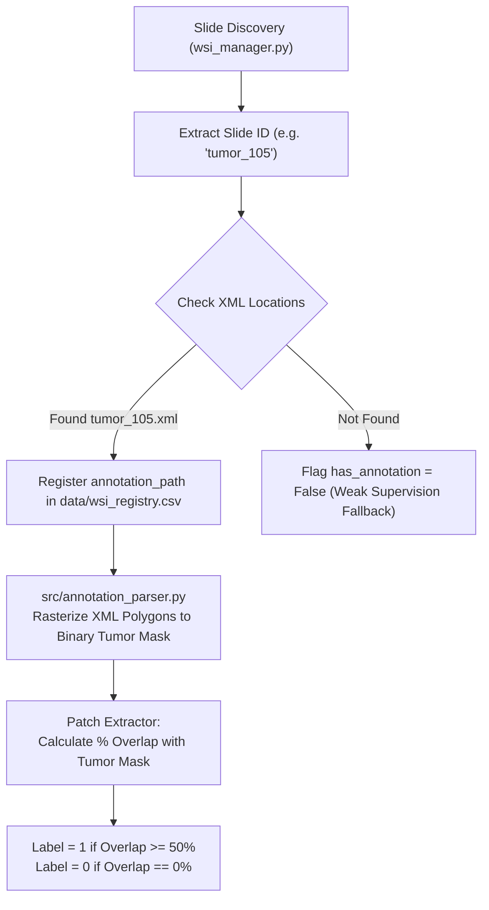

# CAMELYON16 Annotation Status & Integration Guide

## 1. Overview & Current Status
- **Current Total WSIs in Project:** 60 (30 normal, 30 tumor)
- **XML Annotation Files Found:** **111**
- **Downloaded tumor WSIs with matching XML:** **30 of 30**
- **Missing annotations for downloaded tumor WSIs:** **0**
- **Validation Check:** Confirmed via `src/wsi_manager.py` and directory inspection.

---

## 2. Slide Classification & Annotation Requirements

| Slide ID | Slide Category | File Location | Requires XML Annotation? | Rationale |
| :--- | :---: | :--- | :---: | :--- |
| Downloaded normal WSIs | **NORMAL** | `data/RAW/camelyon16/normal/` | **NO** | Normal slides do not require lesion XML for slide-level normal labeling. |
| Downloaded tumor WSIs | **TUMOR** | `data/RAW/camelyon16/tumor/` | **YES** | Tumor slides contain tumor and benign tissue; matching XML contours are required for reliable patch-level labels. All 30 downloaded tumor WSIs currently have matching XML files. |

---

## 3. Expected Filename & Matching Convention

* **Naming Standard:** The annotation file must match the **Slide ID** (`stem` of the WSI file) with a `.xml` extension:
  * For `tumor_105.tif` $\to$ **`tumor_105.xml`**
  * For `tumor_107.tif` $\to$ **`tumor_107.xml`**
* **XML Format Standard:** CAMELYON16 ASAP XML format containing `<Annotations>` and `<Coordinates>`:
  ```xml
  <?xml version="1.0"?>
  <ASAP_Annotations>
      <Annotations>
          <Annotation Name="_0" Type="Polygon" PartOfGroup="_0" Color="#F4FA58">
              <Coordinates>
                  <Coordinate Order="0" X="55080.0" Y="74600.0" />
                  <Coordinate Order="1" X="55150.0" Y="74720.0" />
                  ...
              </Coordinates>
          </Annotation>
      </Annotations>
      <AnnotationGroups>
          <Group Name="_0" NumberOfAnnotations="1">
              <Attributes />
          </Group>
      </AnnotationGroups>
  </ASAP_Annotations>
  ```

---

## 4. Recommended File Placement Locations

The pipeline (`src/wsi_manager.py` and the future `src/annotation_parser.py`) is configured to automatically discover XML annotation files placed in any of the following standard locations:

1. **Option A (Dedicated Annotations Folder - Recommended):**
   ```text
   data/RAW/camelyon16/annotations/
       ├── tumor_105.xml
       └── tumor_107.xml
   ```
2. **Option B (Directly Alongside Tumor WSIs):**
   ```text
   data/RAW/camelyon16/tumor/
       ├── tumor_105.tif
       ├── tumor_105.xml
       ├── tumor_107.tif
       └── tumor_107.xml
   ```

---

## 5. How the Future Annotation Parser Will Associate XML with WSI

The association pipeline operates through a deterministic 4-step workflow:



1. **Slide ID Resolution:** Given a WSI (e.g., `data/RAW/camelyon16/tumor/tumor_105.tif`), the base identifier `tumor_105` is extracted.
2. **Path Discovery:** The system checks the same folder, sibling `annotations/` directories, and recursive searches within `data/RAW/`.
3. **Polygon Parsing:** `src/annotation_parser.py` parses polygon $(X, Y)$ vertices in Level 0 coordinate space.
4. **Patch Label Assignment:**
   * When extracting a patch at $(x, y, 256, 256)$:
     * **Tumor Patch (`label = 1`):** Intersects tumor polygon area by $\ge 50\%$.
     * **Normal Patch (`label = 0`):** Has $0\%$ intersection with tumor polygons.
     * **Ambiguous Boundary Patches ($1\% - 49\%$):** Discarded to maintain clean, high-confidence training data.
